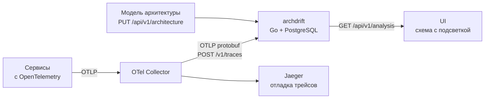

# ArchDrift

**Схема, которая не врёт.**

В любой компании есть красивая архитектурная схема в Confluence, и она устарела в день публикации. Реальная система уже давно другая. Сервисы ходят друг к другу в обход шлюза, кто-то напрямую читает чужую БД, в Kafka появились топики, о которых никто не знает. Ответить на вопрос «а кто вообще вызывает этот эндпоинт?» можно только поиском по коду всей командой.

ArchDrift — инструмент, который восстанавливает фактическую архитектуру системы по телеметрии и сравнивает её с задекларированной.

## Как это работает



1. **Сбор.** Сервисы отправляют трейсы через OpenTelemetry. Collector пересылает их в archdrift, тот сохраняет спаны.
2. **Модель.** Ожидаемая архитектура загружается через API: список узлов и правила `allow` / `deny`.
3. **Анализ.** По запросу за интервал времени archdrift строит фактический граф из сохранённых спанов и проверяет каждую связь по правилам.
4. **Показ.** UI раз в 3–5 секунд запрашивает анализ за последние минуты и рисует граф: разрешённые связи — зелёные, неожиданные — жёлтые, запрещённые — красные. У каждой связи и нарушения есть пример трейса.

## Модель архитектуры

Модель состоит из **узлов**, **правил** и **действия по умолчанию** (`defaultAction`).

### Узлы

| Тип | Что это | Канонический ID |
| --- | --- | --- |
| `service` | Сервис, `service.name` из OpenTelemetry | `service:<serviceName>` |
| `endpoint` | HTTP-обработчик сервиса (метод + шаблон маршрута) | `endpoint:<service>:<method>:<route>` |
| `worker` | Фоновая задача или обработчик Kafka | `worker:<service>:<workerName>` |
| `postgres_database` | База PostgreSQL | `postgres:<instance>:<database>` |
| `kafka_topic` | Топик Kafka | `kafka:<cluster>:<topic>` |

- Части ID кодируются percent-encoding UTF-8: без изменений остаются только `A-Z a-z 0-9 - . _ ~`. Например, маршрут `/orders` превращается в `%2Forders`.
- `endpoint` и `worker` принадлежат сервису через `parentId`.
- `label` — только отображаемое имя, в сопоставлении не участвует.
- Сравнение регистрозависимое.

### Типы связей

| Тип | Откуда → куда | Из каких спанов строится |
| --- | --- | --- |
| `http_call` | service / endpoint / worker → service / endpoint | HTTP CLIENT (+ парный SERVER) |
| `db_query` | service / endpoint / worker → postgres_database | DB CLIENT |
| `publish` | service / endpoint / worker → kafka_topic | Kafka PRODUCER, операция `send` |
| `consume` | kafka_topic → service / endpoint / worker | Kafka CONSUMER, операция `process` |

### Правила

Каждое правило задаёт источник (`from`), назначение (`to`), тип связи (`type`) и действие: разрешить (`allow`) или запретить (`deny`).

| Источник | Тип связи | Назначение | Что регулирует |
| --- | --- | --- | --- |
| Сервис A | `http_call` | Сервис B | HTTP-вызовы из A во все endpoints B |
| Сервис A | `http_call` | Endpoint B | Вызовы конкретного endpoint из A |
| Endpoint A | `http_call` | Сервис B | Вызовы любых endpoints B из обработчика A |
| Endpoint A | `http_call` | Endpoint B | Вызов конкретного endpoint из другого |
| Воркер A | `http_call` | Сервис B | Вызовы любых endpoints B из воркера |
| Воркер A | `http_call` | Endpoint B | Вызов конкретного endpoint из воркера |
| Сервис | `db_query` | PostgreSQL-база | Запросы к БД из сервиса и его операций |
| Endpoint | `db_query` | PostgreSQL-база | Запросы к БД из HTTP-обработчика |
| Воркер | `db_query` | PostgreSQL-база | Запросы к БД из фоновой задачи |
| Сервис | `publish` | Kafka-топик | Публикации из сервиса и его операций |
| Endpoint | `publish` | Kafka-топик | Публикации из HTTP-обработчика |
| Воркер | `publish` | Kafka-топик | Публикации из фоновой задачи |
| Kafka-топик | `consume` | Сервис | Обработка сообщений операциями сервиса |
| Kafka-топик | `consume` | Воркер | Обработка сообщений конкретным обработчиком |
| Kafka-топик | `consume` | Endpoint | Обработка сообщений внутри HTTP-запроса |

Сервис в любом конце правила охватывает себя и принадлежащие ему endpoints и воркеры. Конкретный endpoint, воркер, база или топик совпадает только с самим собой. Для `consume` направление отражает движение данных: от топика к обработчику.

Для `db_query` можно задать фильтр `dbOperations`: `SELECT`, `INSERT`, `UPDATE`, `DELETE`, `OTHER`. Без фильтра правило действует на все операции БД.

### Как принимается решение

Для каждой наблюдаемой связи:

1. Есть хотя бы одно совпавшее правило `deny` → **`forbidden`** (красная). `deny` побеждает всегда, независимо от детализации и порядка правил.
2. Иначе есть совпавшее `allow` → **`allowed`** (зелёная).
3. Иначе совпадений нет → решает `defaultAction`: `allow` → `allowed`, `deny` → **`unexpected`** (жёлтая).

Поле `decisionSource` показывает, откуда решение: `rules` или `default`. В `matchedRuleIds` перечислены все совпавшие правила.

### Нарушения

| Тип | Когда |
| --- | --- |
| `forbidden_edge` | Связь запрещена правилом `deny` |
| `unexpected_edge` | Связь не покрыта правилами, а `defaultAction = deny` |
| `unknown_node` | В трейсах встретился узел, которого нет в модели |

- Один результат на ключ ребра и тип нарушения.
- У каждого нарушения есть `exampleTraceId` — трейс-доказательство, его можно открыть в Jaeger.
- Узлы и связи из модели, которые не встретились в трейсах, нарушениями **не считаются**: у таких узлов просто `observed = false`.

### Пример модели для демо

```json
{
  "defaultAction": "deny",
  "nodes": [
    { "id": "service:gateway",  "label": "Gateway",  "type": "service", "serviceName": "gateway" },
    { "id": "service:orders",   "label": "Orders",   "type": "service", "serviceName": "orders" },
    { "id": "service:payments", "label": "Payments", "type": "service", "serviceName": "payments" },
    { "id": "service:notifications", "label": "Notifications", "type": "service", "serviceName": "notifications" },

    { "id": "endpoint:gateway:POST:%2Forders", "label": "POST /orders", "type": "endpoint", "parentId": "service:gateway", "method": "POST", "route": "/orders" },
    { "id": "endpoint:orders:POST:%2Forders",  "label": "POST /orders", "type": "endpoint", "parentId": "service:orders",  "method": "POST", "route": "/orders" },
    { "id": "worker:payments:order-created",      "label": "order-created", "type": "worker", "parentId": "service:payments",      "workerName": "order-created" },
    { "id": "worker:notifications:order-created", "label": "order-created", "type": "worker", "parentId": "service:notifications", "workerName": "order-created" },

    { "id": "postgres:main:orders_db",   "label": "orders_db",   "type": "postgres_database", "instance": "main", "database": "orders_db" },
    { "id": "postgres:main:payments_db", "label": "payments_db", "type": "postgres_database", "instance": "main", "database": "payments_db" },
    { "id": "kafka:main:order.created",  "label": "order.created", "type": "kafka_topic", "cluster": "main", "topic": "order.created" }
  ],
  "rules": [
    { "id": "gw-orders",              "from": "service:gateway",  "to": "service:orders",            "type": "http_call", "action": "allow" },
    { "id": "orders-db",              "from": "service:orders",   "to": "postgres:main:orders_db",   "type": "db_query",  "action": "allow" },
    { "id": "orders-publish",         "from": "service:orders",   "to": "kafka:main:order.created",  "type": "publish",   "action": "allow" },
    { "id": "payments-consume",       "from": "kafka:main:order.created", "to": "service:payments",      "type": "consume", "action": "allow" },
    { "id": "notifications-consume",  "from": "kafka:main:order.created", "to": "service:notifications", "type": "consume", "action": "allow" },
    { "id": "payments-db",            "from": "service:payments", "to": "postgres:main:payments_db", "type": "db_query",  "action": "allow" },
    { "id": "no-shared-orders-db",    "from": "service:payments", "to": "postgres:main:orders_db",   "type": "db_query",  "action": "deny" }
  ]
}
```

Endpoints и воркеры, которые встречаются в трейсах, нужно объявить в модели. Иначе каждый из них станет нарушением `unknown_node`, даже если связь разрешена правилом сервиса. По той же причине служебные маршруты вроде `/health` не должны попадать в трейсы демо-сервисов.

Загрузка модели:

```bash
curl -X PUT localhost:8080/api/v1/architecture \
  -H 'Content-Type: application/json' \
  -d @model.json
```

## Требования к инструментации

ArchDrift видит только то, что есть в трейсах. Полное соглашение — в [instrumentation.yaml](backend/api/instrumentation.yaml). Кратко:

| Что | Обязательные атрибуты |
| --- | --- |
| Любой сервис | `service.name` в ресурсе |
| HTTP | CLIENT и SERVER с `http.request.method`; на SERVER по возможности `http.route` |
| Воркер | Спан запуска задачи с `archdrift.worker.name` |
| PostgreSQL | CLIENT с `db.system.name=postgresql`, `db.namespace=<база>`, `archdrift.postgres.instance=<инстанс>`; по возможности `db.operation.name` |
| Kafka | `messaging.system=kafka`, `messaging.destination.name=<топик>`, `archdrift.kafka.cluster=<кластер>`, `messaging.operation.type` = `send` / `process` |

- Атрибуты `archdrift.*` — соглашение проекта, а не стандарт OpenTelemetry.
- Логические имена `instance` и `cluster` одинаковы во всех сервисах; IP, адреса и порты в ID не используются.
- Если не удалось определить endpoint или воркер, связь строится на уровне сервиса, а случай учитывается в `diagnostics`.
- Если у спана БД или Kafka неполная идентичность ресурса, ребро не строится (`unresolvedResourceSpans`).

**Важно:** отсутствие нарушений при неполной инструментации не доказывает, что система соответствует модели. Для этого и нужен блок `diagnostics`.

## API

- [OpenAPI-спецификация](backend/api/api.yaml)
- [Соглашения об инструментации](backend/api/instrumentation.yaml)

| Метод | Путь | Назначение |
| --- | --- | --- |
| `POST` | `/v1/traces` | Приём трейсов от Collector (OTLP protobuf, без сжатия, до 4 МиБ) |
| `GET` | `/api/v1/architecture` | Текущая модель архитектуры |
| `PUT` | `/api/v1/architecture` | Полная замена модели (JSON) |
| `GET` | `/api/v1/analysis?from=…&to=…` | Граф и нарушения за интервал `[from, to)`, не больше 24 ч |
| `GET` | `/api/v1/traces/{traceId}` | Сохранённые спаны трейса |
| `GET` | `/healthz` | Процесс жив |
| `GET` | `/readyz` | БД доступна, миграции завершены |

## Быстрый старт

Нужны Docker и Git.

```bash
git clone https://github.com/panchill/ArchDrift.git
cd ArchDrift
cp .env.example .env
make up
```

| Что | Адрес |
| --- | --- |
| ArchDrift UI | http://localhost:5173 |
| ArchDrift API | http://localhost:8080 |
| Jaeger | http://localhost:16686 |

Остальные команды: `make down` — остановить, `make reset` — остановить и стереть данные, `make logs` — логи.

## Демо-сценарий

Демо-магазин: `gateway` → `orders` → `orders_db` и Kafka `order.created` → `payments` (`payments_db`) и `notifications`.

1. `make up` — поднимается стенд, генератор нагрузки создаёт заказы.
2. Открыть UI — все связи зелёные.
3. Включить «плохой» вызов (`make bad-on` или кнопка в UI): сервис `payments` начинает читать `orders_db`.
4. Через несколько секунд связь `payments → orders_db` становится красной (`forbidden`), в списке нарушений появляется запись с примером трейса.
5. Выключить (`make bad-off`) — связь пропадает из анализа, когда выходит за окно времени.

