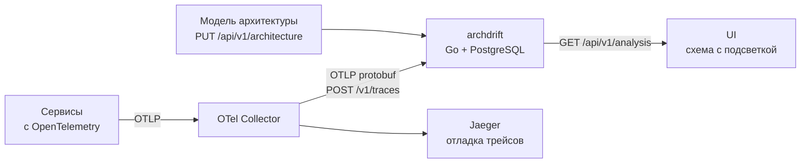
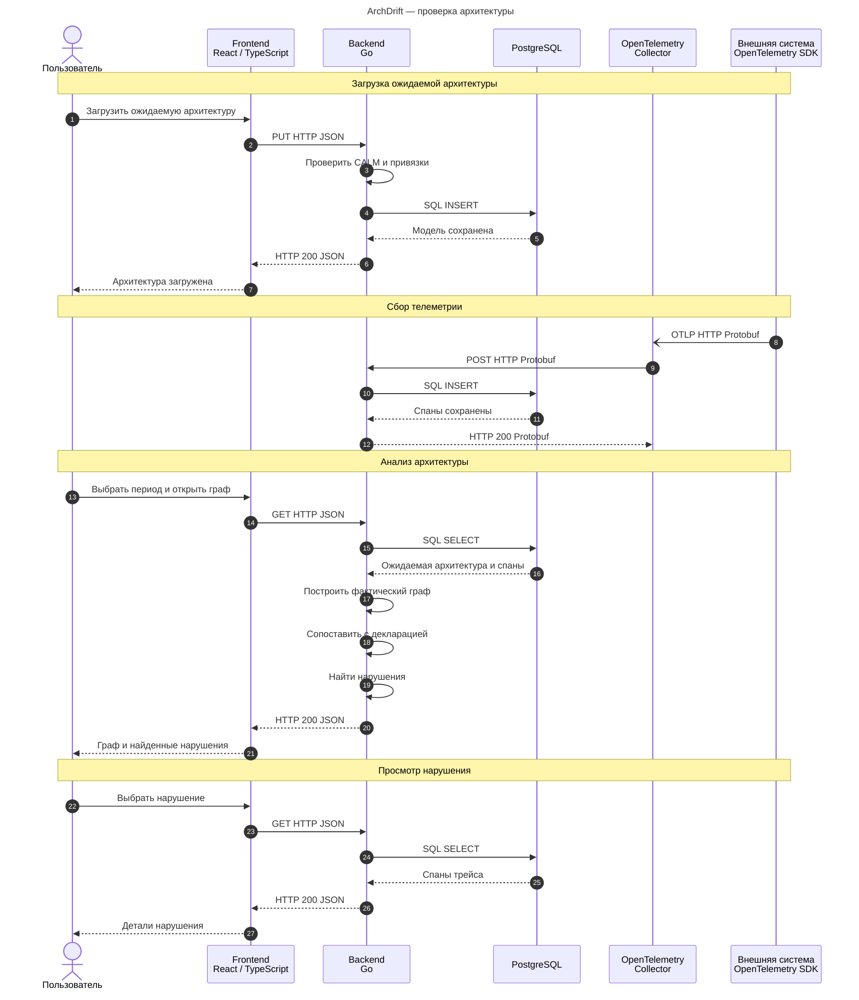

# ArchDrift

Локальный фронтенд с CALM-моком и графом: [запуск и тесты](frontend/README.md).

**Схема, которая не врёт.**

В любой компании есть красивая архитектурная схема в Confluence, и она устарела в день публикации. Реальная система уже давно другая. Сервисы ходят друг к другу в обход шлюза, кто-то напрямую читает чужую БД, в Kafka появились топики, о которых никто не знает. Ответить на вопрос «а кто вообще вызывает этот эндпоинт?» можно только поиском по коду всей командой.

ArchDrift — инструмент, который восстанавливает фактическую архитектуру системы по телеметрии и сравнивает её с задекларированной.

## Как это работает



1. **Сбор.** Сервисы отправляют трейсы через OpenTelemetry. Collector пересылает их в archdrift, тот сохраняет спаны.
2. **Модель.** Ожидаемая архитектура загружается через API: CALM 1.2 JSON с узлами, связями и привязками к телеметрии.
3. **Анализ.** По запросу за интервал времени archdrift строит фактический граф из сохранённых спанов и сопоставляет каждую связь с декларацией.
4. **Показ.** UI раз в 3–5 секунд запрашивает анализ за последние минуты и рисует граф: задекларированные связи — зелёные, незадекларированные — красные, недостаточно данных — серые. У каждой связи и нарушения есть пример трейса.



## Модель архитектуры

Ожидаемая модель — **FINOS CALM 1.2**. `PUT /api/v1/architecture` принимает CALM JSON без обёртки; `GET` возвращает его в `model` вместе с версией. В самом CALM обязательна ревизия `metadata.archdrift.version`. Профиль MVP и привязки к OpenTelemetry описаны в `calmProfile` файла [instrumentation.yaml](backend/api/instrumentation.yaml).

Версия защищает от потери изменений при одновременном редактировании:

1. Для первого создания передать `metadata.archdrift.version: 0`. Сервер сохранит модель с версией `1`.
2. Для обновления получить модель через `GET`, отредактировать её и отправить `model` через `PUT`, оставив прочитанную версию. Увеличивать её самостоятельно не нужно.
3. Сервер атомарно проверяет версию и сохраняет следующую. Например, из двух обновлений версии `3` одно сохранится как `4`, второе получит `409 architecture_version_conflict` с `currentVersion: 4`.
4. При конфликте загрузить свежую модель и объединить изменения. Простая подстановка нового номера и повторный PUT могут затереть чужую работу.

В ответах `version` всегда равен `model.metadata.archdrift.version`. Это счётчик ревизий ArchDrift, отдельный от версии стандарта CALM `1.2`. История моделей не хранится. Отсутствующая или некорректная ревизия даёт `400`; конфликт не меняет данные и время обновления.

Бэкенд реализует PUT/GET модели, проверку CALM и атомарную проверку ревизии в PostgreSQL. Инструкции загрузки и проверки — в [backend/README.md](backend/README.md). Фронтенд пока использует согласованные JSON-моки.

Узлы CALM: `service`, `worker`, `database` (PostgreSQL), `kafka-topic`. HTTP endpoints — интерфейсы сервиса. Связи — `connects`; `composed-of` связывает worker с сервисом. Привязки к телеметрии обязательны в `metadata.archdrift`.

Ниже — нормализованные узлы **выходного графа**; их канонические ID отличаются от произвольных CALM `unique-id`.

### Узлы

| Тип | Что это | Канонический ID |
| --- | --- | --- |
| `service` | Сервис, `service.name` из OpenTelemetry | `service:<serviceName>` |
| `endpoint` | HTTP-обработчик сервиса (метод + шаблон маршрута) | `endpoint:<service>:<method>:<route>` |
| `worker` | Фоновая задача или обработчик Kafka | `worker:<service>:<workerName>` |
| `postgres_database` | База PostgreSQL | `postgres:<instance>:<database>` |
| `kafka_topic` | Топик Kafka | `kafka:<cluster>:<topic>` |

- Части ID кодируются percent-encoding UTF-8: без изменений остаются только `A-Z a-z 0-9 - . _ ~`. Например, маршрут `/orders` превращается в `%2Forders`.
- `endpoint` и `worker` принадлежат сервису через `parentId`.
- `label` — только отображаемое имя, в сопоставлении не участвует.
- Сравнение регистрозависимое.

### Типы связей

| Тип | Откуда → куда | Из каких спанов строится |
| --- | --- | --- |
| `http_call` | service / endpoint / worker → service / endpoint | HTTP или gRPC CLIENT (+ парный SERVER) |
| `db_query` | service / endpoint / worker → postgres_database | DB CLIENT |
| `publish` | service / endpoint / worker → kafka_topic | Kafka PRODUCER, операция `send` |
| `consume` | kafka_topic → service / endpoint / worker | Kafka CONSUMER, операция `process` |

### Поддерживаемые декларации

`connects` задаёт `source` и `destination`: CALM ID узла и необязательный список `interfaces`. Без списка связь охватывает весь сервис. Необязательный `metadata.archdrift.type` уточняет вид операции; без него подходят все совместимые виды.

| Источник | Тип связи | Назначение | Что описывает |
| --- | --- | --- | --- |
| Сервис A | `http_call` | Сервис B | HTTP-вызовы из A во все endpoints B |
| Сервис A | `http_call` | Endpoint B | Вызовы конкретного endpoint из A |
| Endpoint A | `http_call` | Сервис B | Вызовы любых endpoints B из обработчика A |
| Endpoint A | `http_call` | Endpoint B | Вызов конкретного endpoint из другого |
| Воркер A | `http_call` | Сервис B | Вызовы любых endpoints B из воркера |
| Воркер A | `http_call` | Endpoint B | Вызов конкретного endpoint из воркера |
| Сервис | `db_query` | PostgreSQL-база | Запросы к БД из сервиса и его операций |
| Endpoint | `db_query` | PostgreSQL-база | Запросы к БД из HTTP-обработчика |
| Воркер | `db_query` | PostgreSQL-база | Запросы к БД из фоновой задачи |
| Сервис | `publish` | Kafka-топик | Публикации из сервиса и его операций |
| Endpoint | `publish` | Kafka-топик | Публикации из HTTP-обработчика |
| Воркер | `publish` | Kafka-топик | Публикации из фоновой задачи |
| Kafka-топик | `consume` | Сервис | Обработка сообщений операциями сервиса |
| Kafka-топик | `consume` | Воркер | Обработка сообщений конкретным обработчиком |
| Kafka-топик | `consume` | Endpoint | Обработка сообщений внутри HTTP-запроса |

Сервис в любом конце связи охватывает себя и принадлежащие ему endpoints и воркеры. Конкретный endpoint, воркер, база или топик совпадает только с самим собой. Для `consume` направление отражает движение данных: от топика к обработчику.

### Как принимается решение

| Статус | Условие |
| --- | --- |
| `declared` | Есть хотя бы одна полностью совпавшая декларация |
| `indeterminate` | Полного совпадения нет, но при уточнении service-level fallback мог бы совпасть конкретный endpoint/worker |
| `unexpected` | Нет ни полного, ни возможного совпадения; создаётся `unexpected_edge` |

- `matchedRelationshipIds` содержит CALM ID всех совпавших `connects`, иначе пуст.
- Широкая связь A → B покрывает вызовы всех частей A в endpoints B. Конкретная связь рядом не сужает широкую.
- Направление учитывается; обратные и транзитивные связи автоматически не выводятся.
- SQL-операции остаются детализацией наблюдений, без отдельных фильтров.
- Узлы без точного объявления имеют `known=false`; это само по себе не нарушение. Необъявленный endpoint или worker может быть покрыт связью сервисов.
- Ненаблюдаемые связи не считаются нарушениями. Неполная телеметрия отражается в `diagnostics`.
- У каждого `unexpected_edge` есть пример трейса. Отдельной политики разрешений нет.

### Пример CALM-модели

Минимальный пример: любой HTTP-вызов `gateway` → `orders` соответствует декларации. Узлы, БД и Kafka-связи демо добавляются по тому же профилю.

```json
{
  "$schema": "https://calm.finos.org/release/1.2/meta/calm.json",
  "metadata": {"archdrift": {"version": 0}},
  "nodes": [
    {
      "unique-id": "gateway", "node-type": "service",
      "name": "Gateway", "description": "Входной сервис",
      "metadata": {"archdrift": {"serviceName": "gateway"}}
    },
    {
      "unique-id": "orders", "node-type": "service",
      "name": "Orders", "description": "Сервис заказов",
      "metadata": {"archdrift": {"serviceName": "orders"}}
    }
  ],
  "relationships": [
    {
      "unique-id": "gateway-to-orders",
      "relationship-type": {
        "connects": {"source": {"node": "gateway"}, "destination": {"node": "orders"}}
      },
      "metadata": {"archdrift": {"type": "http_call"}}
    }
  ]
}
```

Загрузка модели с хоста (порт 8081: на 8080 отвечает магазин OpenTelemetry Demo; внутри compose API слушает 8080):

```bash
curl -X PUT localhost:8081/api/v1/architecture \
  -H 'Content-Type: application/json' \
  -d @model.json
```

## Требования к инструментации

ArchDrift видит только то, что есть в трейсах. Полное соглашение — в [instrumentation.yaml](backend/api/instrumentation.yaml). Кратко:

| Что | Обязательные атрибуты |
| --- | --- |
| Любой сервис | `service.name` в ресурсе |
| HTTP | CLIENT и SERVER с `http.request.method`; на SERVER по возможности `http.route` |
| gRPC | CLIENT и SERVER с `rpc.system`/`rpc.system.name=grpc` и `rpc.method`; считается HTTP `POST /<pkg.Service>/<Method>` |
| Воркер | Спан запуска задачи с `archdrift.worker.name` |
| PostgreSQL | CLIENT с `db.system.name=postgresql`, `db.namespace=<база>`, `archdrift.postgres.instance=<инстанс>`; по возможности `db.operation.name` |
| Kafka | `messaging.system=kafka`, `messaging.destination.name=<топик>`, `archdrift.kafka.cluster=<кластер>`, `messaging.operation.type` = `send` / `process` |
 
- Атрибуты `archdrift.*` — соглашение проекта, а не стандарт OpenTelemetry.
- Логические имена `instance` и `cluster` одинаковы во всех сервисах; IP, адреса и порты в ID не используются.
- Если не удалось определить endpoint или воркер, связь строится на уровне сервиса, а случай учитывается в `diagnostics`.
- Если у спана БД или Kafka неполная идентичность ресурса, ребро не строится (`unresolvedResourceSpans`).

**Важно:** отсутствие нарушений при неполной инструментации не доказывает, что система соответствует модели. Для этого и нужен блок `diagnostics`.

## API

- [OpenAPI-спецификация](backend/api/api.yaml)
- [Соглашения об инструментации](backend/api/instrumentation.yaml)
- [Просмотр CALM-модели как сайта](docs/calm.md)

| Метод | Путь | Назначение |
| --- | --- | --- |
| `POST` | `/v1/traces` | Приём трейсов от Collector (OTLP protobuf, без сжатия, до 4 МиБ) |
| `GET` | `/api/v1/architecture` | Текущая модель архитектуры |
| `PUT` | `/api/v1/architecture` | Полная замена модели (CALM 1.2 JSON) |
| `GET` | `/api/v1/analysis?from=…&to=…` | Граф и нарушения за интервал `[from, to)`, не больше 24 ч |
| `GET` | `/api/v1/traces/{traceId}` | Сохранённые спаны трейса |
| `GET` | `/healthz` | Процесс жив |
| `GET` | `/readyz` | БД доступна, миграции завершены |

## Быстрый старт

Нужны Docker (не меньше 6 ГБ памяти) и Git. Порт 8080 на хосте занимает магазин Demo, поэтому API ArchDrift снаружи на 8081.

```bash
git clone https://github.com/panchill/ArchDrift.git
cd ArchDrift
make up
```

`make up` клонирует [OpenTelemetry Demo](https://github.com/open-telemetry/opentelemetry-demo) релиза 3.1.0 в `opentelemetry-demo/` (каталог в `.gitignore`) и поднимает Demo вместе с archdrift. Уже существующую копию команда не перезаписывает. Другой тег: `make up DEMO_REF=3.1.0`.

| Что | Адрес |
| --- | --- |
| Магазин Astronomy Shop | http://localhost:8080 |
| Jaeger | http://localhost:8080/jaeger/ui |
| Grafana | http://localhost:8080/grafana/ |
| ArchDrift API | http://localhost:8081 |
| ArchDrift UI | http://localhost:5173 |

Collector Demo дополнительно шлёт трейсы OTLP/HTTP protobuf без сжатия на `http://archdrift:8080/v1/traces`. На хосте тот же приём доступен как `http://localhost:8081/v1/traces`.

Остальные команды: `make down` — остановить, `make reset` — остановить и стереть данные, `make logs` — логи.

Атрибуты `archdrift.*` в спаны Demo добавляют процессоры Collector. Пока их нет, трейсы уже доходят до archdrift, но часть рёбер PostgreSQL и Kafka может не собраться.

## Демо-сценарий

Наблюдаемая система — OpenTelemetry Demo, Astronomy Shop. Своих сервисов нет, нагрузку даёт load-generator Demo.

1. `make up` — поднимается стенд, генератор создаёт заказы, трейсы приходят в archdrift.
2. UI на http://localhost:5173 пока рисует согласованные моки. Живой граф подключает отдельная задача.
3. Сценарий защиты «устаревшая модель» (`make model` / `make model-stale`) появится вместе с загрузкой CALM: связь checkout → email должна стать красной, затем снова зелёной.

## CI

[GitHub Actions](.github/workflows/ci.yml) запускается для PR в `main`, push в `main`
и вручную через `workflow_dispatch`. Три независимые jobs выполняются параллельно.

### Frontend

Node.js из `frontend/.nvmrc`: `npm ci`, `npm run test:frontend`, затем `npm run build`.
Проверяются граф, HTTP-клиент, React/Cytoscape, TypeScript и production-сборка.
Контрактные тесты исключены из этого запуска тестов.

### Contracts

Отдельный запуск `npm run test:contracts` после `npm ci` в `frontend/`:

- `architecture.json` воспроизводится генератором из эталона в `examples/`; устаревшая копия отклоняется без перезаписи.
- Моки ответов `Architecture` и `Analysis` соответствуют схемам из `backend/api/api.yaml`.
- CALM-модель мока и пример из `examples/` соответствуют официальным локальным схемам CALM 1.2.
- Проверяются ревизии модели, канонические ID и соответствие статусов связей декларации.
- CALM ID узлов уникальны; ссылки связей и интерфейсов разрешаются; у воркера ровно один владелец.
- Связи анализа ссылаются на существующие узлы и CALM-связи; SQL-операции, счётчики,
  временные границы, статусы и примеры трейсов согласованы с нарушениями.
- Нет дубликатов ключей связей; представлены все три статуса анализа.

Это проверка фикстур и использованных ими схем, не полная валидация документа OpenAPI.
Тесты не проверяют все ограничения профиля `instrumentation.yaml`, совместимость
с предыдущей версией API или ответы работающего бэкенда.

### Backend

После появления `backend/go.mod` автоматически выполняются проверка `gofmt`,
`go vet ./...` и `go test ./...` в `backend/`. Версия Go берётся из `go.mod`.
Пока модуля нет, Go-шаги пропускаются с явной записью в summary; это не означает,
что бэкенд протестирован. Запуск стенда пока не настроен.

Изменения любых файлов запускают CI, включая `backend/api/`. Устаревший запуск для
того же PR отменяется при новом коммите. Дополнительные секреты не нужны.

Локально `cd frontend && npm test` по-прежнему запускает оба набора тестов вместе.

Для обязательного прохождения перед merge нужно отдельно включить required status
checks `Frontend`, `Contracts` и `Backend` в правилах защиты `main` после первого запуска.
Если ранее требовался `Frontend and API contracts`, его нужно заменить новыми именами.
