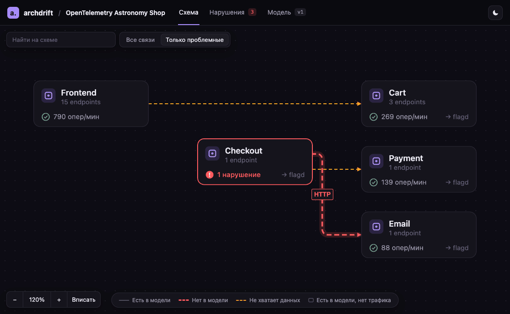
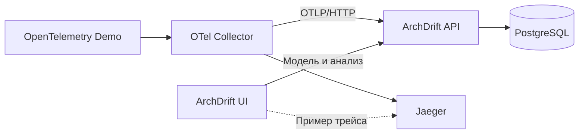
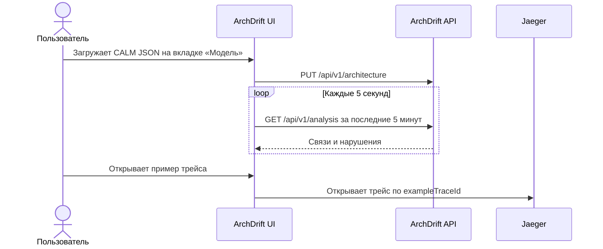

# ArchDrift

ArchDrift сравнивает модель архитектуры в FINOS CALM 1.2 со связями из OpenTelemetry-трейсов. На схеме видно, кто кого вызывает, каких связей нет в модели и где не хватает данных. Из панели связи можно открыть пример трейса в Jaeger.



*Интерфейс на тестовых данных OpenTelemetry Demo.*

## Быстрый старт

Нужны Git, Make, Docker с Compose v2, `curl` и `jq`. Выделите Docker **не менее 6 ГБ оперативной памяти**.

```sh
git clone https://github.com/panchill/ArchDrift.git
cd ArchDrift
make up
make model
```

`make up` поднимает ArchDrift и [OpenTelemetry Demo](https://github.com/open-telemetry/opentelemetry-demo) 3.1.0. Трафик создаёт штатный генератор Astronomy Shop.

| Что открыть | Адрес |
| --- | --- |
| Схема ArchDrift | [localhost:5173](http://localhost:5173) |
| ArchDrift API | [localhost:8081/healthz](http://localhost:8081/healthz) |
| Магазин Astronomy Shop | [localhost:8080](http://localhost:8080) |
| Jaeger | [localhost:8080/jaeger/ui](http://localhost:8080/jaeger/ui) |

## Сценарий демо

1. Откройте **Схему** и дождитесь связи **Checkout → Email**.
2. Выполните `make model-stale`. Из модели исчезнет эта связь. На схеме она станет красной, а во вкладке **Нарушения** появится запись с примером трейса.
3. Выполните `make model`. Связь снова станет серой.

Остановить стенд можно командой `make down`.

## Как это работает

Collector дополняет спаны атрибутами `archdrift.*`. ArchDrift сохраняет спаны и сопоставляет наблюдаемые HTTP/gRPC-вызовы, запросы к PostgreSQL и операции Kafka с моделью.



| Связь на схеме | Статус |
| --- | --- |
| Серая | Есть в модели (`declared`) |
| Красная пунктирная | Нет в модели (`unexpected`) |
| Жёлтая пунктирная | Не хватает данных (`indeterminate`) |

<details>
<summary>Загрузка модели и просмотр трейса</summary>



</details>

## Модель архитектуры

Возьмите [CALM-модель Astronomy Shop](examples/opentelemetry-demo.architecture.json) и загрузите её на вкладке **Модель**. Привязки узлов к телеметрии задаются в `metadata.archdrift` по правилам `calmProfile`. [Профиль CALM](backend/api/instrumentation.yaml)

## Локальный фронтенд

Используйте версию Node.js из [`frontend/.nvmrc`](frontend/.nvmrc).

```sh
cd frontend
npm ci
VITE_MOCKS=1 npm run dev
```

| Переменная | Что задаёт |
| --- | --- |
| `ARCHDRIFT_API_URL` | Адрес API для прокси Vite. По умолчанию `http://localhost:8081` |
| `VITE_MOCKS=1` | Тестовые данные для запуска без бэкенда |
| `VITE_JAEGER_URL` | Адрес Jaeger. По умолчанию `http://localhost:8080/jaeger/ui` |

## Документация

- [OpenAPI](backend/api/api.yaml) и [инструментация OpenTelemetry](backend/api/instrumentation.yaml)
- [Локальная разработка фронтенда](frontend/README.md) и [бэкенда](backend/README.md)
- [Просмотр CALM-модели](docs/calm.md)
- [CI и тесты](docs/ci.md)
- [Ссылка на презентацию](https://docs.google.com/presentation/d/1w6pg9ssCyWDO8zPHga0J3pnRvvUVSsNGfThyUJkGd0o/edit?usp=sharing)
