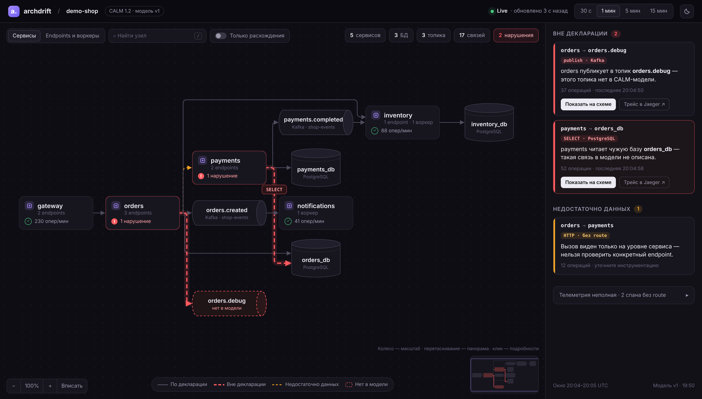

# Требования к UI ArchDrift

Цель: схема, по которой жюри за пару секунд видит **поток вызовов слева направо** и **красное расхождение**. Сейчас UI выглядит устаревшим: граф раскладывается «змейкой», рёбра пересекают весь холст, текст мелкий и бледный, статусы не выделяются.

- **Референс стиля** — схема проекта в Railway: тёмный холст в точку, карточки с иконкой, названием и строкой статуса, группы, аккуратные связи.
- **Макет:** [docs/ui/mockup.html](ui/mockup.html), скриншот — [docs/ui/mockup.png](ui/mockup.png). Это статичная картинка на данных текущего мока demo-shop. Ориентир по виду, а не код для копирования.
- Функциональность, которая есть сейчас, **сохраняется**: масштаб и панорама, перетаскивание узлов, «Вписать», поиск, фильтр связей, режимы «Сервисы» / «Endpoints и воркеры», выбор узла или связи с подробностями, список нарушений, скачивание CALM, работа на моках.
- Контракт и типы данных (`api.yaml`, `src/types.ts`) не меняются. Это только отображение.

## 1. Раскладка: поток слева направо (P0)

Главное требование. Цепочку вызова должно быть видно глазом без «игры в змейку». Пример из мока: `payments → payments.completed → inventory → inventory_db` — четыре узла на одной линии, стрелки идут только вправо.

1. **Слоёная раскладка слева направо.** Ранг узла — длина пути вызовов до него. В ранжировании участвуют **все** типы узлов, а не только сервисы:
   - `http_call`: вызывающий сервис → вызываемый;
   - `publish`: сервис → топик;
   - `consume`: топик → сервис-потребитель (в контракте `source` = топик);
   - `db_query`: сервис → база.

   Топики и базы стоят **в потоке**, между производителем и потребителем, а не отдельной колонкой справа. Нынешнее ограничение в три колонки (`Math.min(rank, 2)` в `layout.ts`) убрать.
2. **Рёбра только вправо.** Выходят из правой стороны узла, входят в левую. Исключение — циклы: обратное ребро обходит граф снизу, но тоже не идёт по диагонали через схему.
3. **Ортогональные линии со скруглёнными углами**, без диагоналей. Исходящие рёбра одного узла выходят общим «стволом» и расходятся у цели.
4. **Минимум пересечений.** Порядок узлов внутри колонки подбирать так, чтобы связанные узлы стояли на одной высоте (как ряд `payments.completed → inventory → inventory_db` в макете).
5. **Узлы не прыгают** при опросе раз в 3–5 секунд. Раскладка пересчитывается только при смене набора узлов. Существующие узлы сохраняют позиции, новые добавляются. Позиции, перетащенные руками, не сбрасываются до «Вписать».
6. **При первой загрузке** граф вписывается в холст с отступом.
7. **Проверка на Demo.** Раскладку проверять на моках OpenTelemetry Demo (#29): 23 сервиса, 61 endpoint. На 5 сервисах проблемы не видны.

**Как реализовать — два варианта:**
- **A. ELK, раскладка layered** (`cytoscape-elk` + `elkjs`) — рекомендуется. Готовые слои, порядок с минимумом пересечений, ортогональная трассировка. Это новая зависимость, по AGENTS.md её одобряет тимлид. Обоснование: самописная раскладка не масштабируется на граф Demo.
- **B. Доработать свой `layout.ts`.** Ранжировать все узлы, упорядочить колонки эвристикой, рёбра — `curve-style: taxi`, `taxi-direction: rightward`. Без зависимостей, но качество хуже, особенно на Demo.

## 2. Узлы (P0)

| Тип | Вид |
|---|---|
| Сервис | Карточка ~180×80, скругление 12. Иконка в цветной плашке, имя полужирным, подпись (`3 endpoints · 1 воркер`), строка статуса: `✓ 230 опер/мин` или красное `! 1 нарушение` |
| PostgreSQL | **Стоячий цилиндр**: имя БД и подпись `PostgreSQL` |
| Kafka-топик | **Лежачий цилиндр**: имя топика и подпись `Kafka · <cluster>` |
| Endpoint, воркер (детальный режим) | Компактные карточки **внутри группы-контейнера сервиса**, как группа Metabase в Railway: рамка с заголовком сервиса, внутри его endpoints и воркеры |

**Состояния:**
- **Есть нарушение** — красная рамка и строка статуса с числом нарушений.
- **`known: false`** (нет в модели) — красная пунктирная рамка, подпись «нет в модели».
- **`observed: false`** (не наблюдался в окне) — прозрачность 40 %.
- **Выбран** — светлая рамка; связанные узлы и рёбра подсвечены, остальное приглушено (см. §3, режим фокуса).

Шестиугольники, «бочки» и одинаковые серые прямоугольники убрать.

## 3. Рёбра (P0)

| Статус | Вид |
|---|---|
| `declared` | Нейтральный серый, 1.5 px. Норма уходит на фон: 60 зелёных рёбер — это шум |
| `unexpected` | Красный, 3 px, мягкое свечение под линией, бегущий пунктир. Рисуется поверх остальных |
| `indeterminate` | Жёлтый (amber) пунктир, 1.8 px. Не серый, чтобы не путать с нормой |

- **Стрелка** на конце каждого ребра, в цвет статуса.
- **На красном ребре — плашка с операцией** (`SELECT`, `publish`). У остальных подпись только при наведении или выборе.
- **Свёрнутое ребро** (режим «Сервисы») показывает худший статус и число исходных рёбер, как сейчас.
- **Режим фокуса:** наведение на узел или клик по нарушению — всё, что не связано, гаснет до 15 %.
- **Анимация в момент появления нового `unexpected`** (P1): ребро 3 секунды пульсирует, вверху всплывает «Новое нарушение: checkout → email». Это кульминация демо.

## 4. Страница (P0)

- **На всю ширину экрана.** Холст занимает всё, справа панель 360–400 px. Ограничение ширины контента по центру убрать.
- **Шапка 56 px:**
  - логотип, проект, версия модели (`CALM 1.2 · модель v1`);
  - справа индикатор **Live** с пульсирующей точкой и «обновлено N с назад»;
  - переключатель окна анализа `30 с / 1 мин / 5 мин / 15 мин`;
  - переключатель темы.
- **Плавающие панели поверх холста:**
  - слева вверху — переключатель «Сервисы / Endpoints и воркеры», поиск (горячая клавиша `/`), переключатель **«Только расхождения»** (нарушения и их соседи);
  - справа вверху — счётчики: сервисы, БД, топики, связи и красный счётчик нарушений;
  - слева внизу — масштаб: `− 100% + Вписать`;
  - внизу по центру — **одна** легенда (сейчас она дублируется снизу и справа);
  - справа внизу — миникарта (P2).
- **Правая панель:**
  - **«Вне декларации N»** — карточки с красной полосой слева. В карточке: путь `payments → orders_db` моноширинным, плашка операции (`SELECT · PostgreSQL`), человеческий текст («payments читает чужую базу orders_db — такая связь в модели не описана»), число операций и время последней, кнопки «Показать на схеме» и «Трейс в Jaeger ↗»;
  - **«Недостаточно данных N»** — такие же карточки с жёлтой полосой;
  - **«Телеметрия неполная»** — свёрнутый блок с `diagnostics`;
  - внизу — окно анализа и версия модели;
  - при выборе узла или ребра — его подробности, как сейчас.

## 5. Тема и типографика (P0)

- **Тёмная тема по умолчанию**, в духе Railway. Токены в `:root`:

  | Токен | Значение |
  |---|---|
  | фон страницы | `#0b0a10` |
  | холст | `#0e0d14`, точки `#25232f`, шаг 22 px |
  | карточка | `#17161f`, рамка `#2b2935` |
  | текст | `#ecebf3`, вторичный `#9a97aa`, третичный `#66637a` |
  | акцент | `#a78bfa` |
  | статусы | ок `#46c37b`, нарушение `#ff5a5f`, нет данных `#f5a524` |

- **Светлая тема** — переключатель (P1). На проекторе в светлом зале она может читаться лучше: проверить обе на месте защиты.
- **Шрифт** Inter / системный без засечек. Моноширинный — только для маршрутов, ID и операций.
- **Размеры:** основной текст 14 px, минимальный 12 px. Имена узлов 14–15 px полужирным. Ничего мельче 11 px, бледно-серый текст на сером фоне не использовать.
- **Тени и скругления:** карточки 12 px, кнопки и поля 9 px, мягкая тень у узлов.

## 6. Приоритеты

| Приоритет | Что |
|---|---|
| **P0** | Раскладка слева направо (§1), цилиндры и карточки (§2), стили статусов рёбер (§3), полноширинная страница, правая панель с карточками нарушений, тёмная тема (§4–5) |
| **P1** | Анимация нового нарушения, режим фокуса, «Только расхождения», группы-контейнеры в детальном режиме, светлая тема |
| **P2** | Миникарта, горячие клавиши кроме `/` |

## 7. Готово, когда

- [ ] на моках Demo каждая цепочка вызова читается слева направо; диагональных рёбер через весь холст нет
- [ ] базы — стоячие цилиндры, топики — лежачие, сервисы — карточки со строкой статуса
- [ ] красное ребро видно с другого конца аудитории; серые рёбра не спорят с ним
- [ ] при опросе раз в 3–5 секунд узлы не прыгают
- [ ] масштаб, панорама, «Вписать», поиск, фильтры, режимы и подробности работают как раньше
- [ ] `npm test` и `npm run build` проходят
